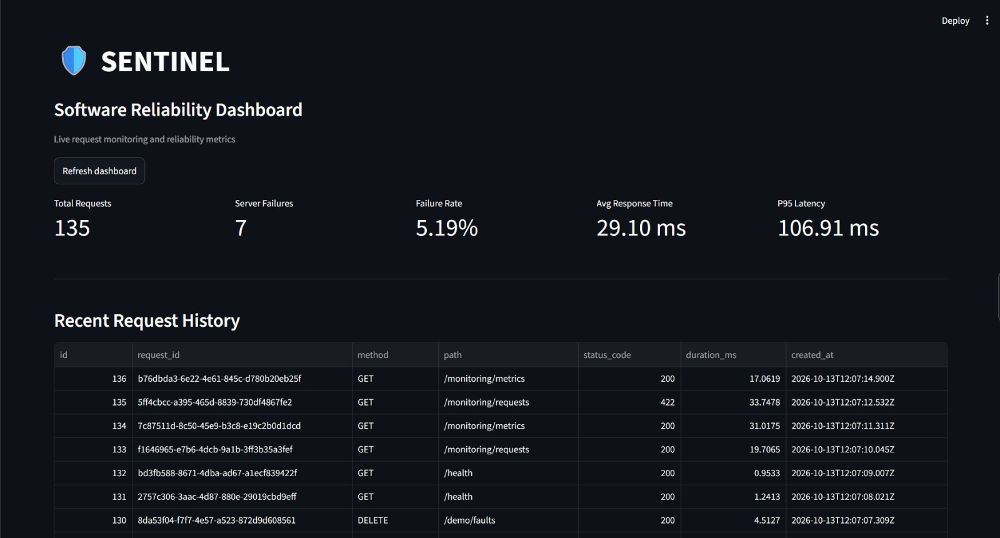
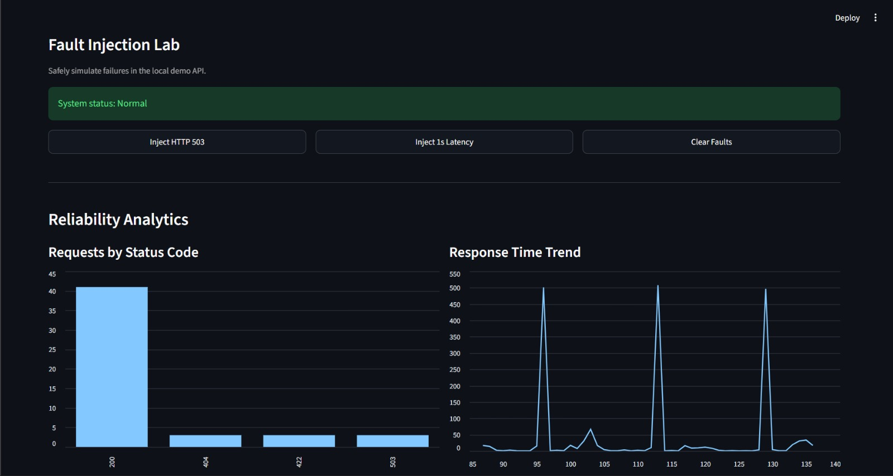
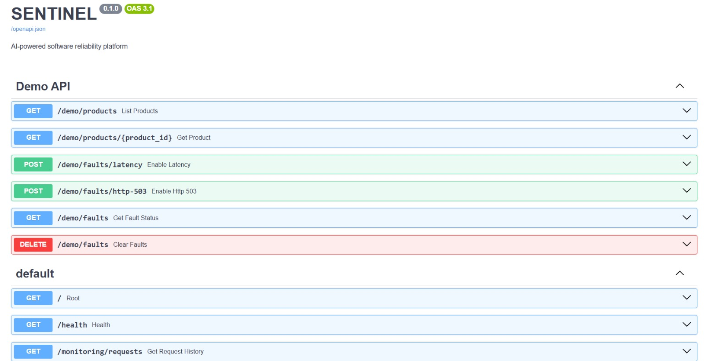
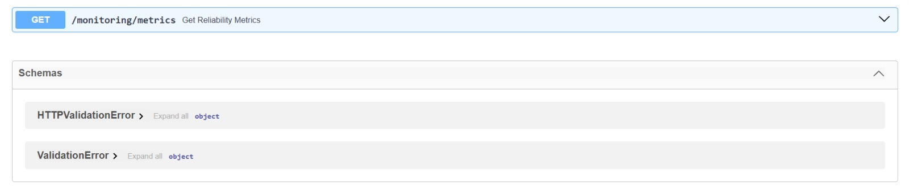

# SENTINEL — Software Reliability & Chaos Engineering Platform

SENTINEL is a Python-based software reliability monitoring MVP that records API activity, measures response times, calculates reliability metrics, and supports controlled fault injection to test service behavior and recovery.

## Features

- **REST API:** FastAPI application with health-check and demo product endpoints.
- **Request correlation:** Unique request IDs returned through the `X-Request-ID` response header.
- **Request logging:** Records HTTP methods, paths, status codes, response durations, and request IDs.
- **Persistent storage:** SQLite database stores request history across application restarts.
- **Reliability metrics:** Calculates total requests, HTTP 5xx failures, failure rate, and average response time.
- **Fault injection:** Simulates HTTP 503 failures and artificial latency, with controls to clear injected faults.
- **Monitoring dashboard:** Streamlit interface with metric cards, request history, status-code charts, and response-time trends.
- **Automated tests:** Pytest tests cover health checks, product endpoints, fault injection, and recovery.

## Tech Stack

- Python
- FastAPI
- Uvicorn
- SQLite
- Streamlit
- Pandas
- HTTPX
- Pytest

## Architecture

```text
                 ┌─────────────────────┐
                 │  Streamlit Dashboard│
                 └──────────┬──────────┘
                            │ HTTP
                 ┌──────────▼──────────┐
                 │    FastAPI App      │
                 │                     │
                 │ Request ID          │
                 │ Request Logging     │
                 │ Demo Product API    │
                 │ Fault Injection     │
                 │ Monitoring Endpoints│
                 └──────────┬──────────┘
                            │
                 ┌──────────▼──────────┐
                 │   SQLite Database   │
                 │    request_logs     │
                 └─────────────────────┘
```

## Prerequisites

- Python 3.11 or later
- Git

## Setup and Installation

### 1. Clone the repository

```bash
git clone <YOUR_GITHUB_REPOSITORY_URL>
cd Sentinel
```

### 2. Create a virtual environment

Windows PowerShell:

```powershell
python -m venv .venv
.\.venv\Scripts\Activate.ps1
```

### 3. Install dependencies

```powershell
python -m pip install -r requirements.txt
```

### 4. Start the FastAPI server

```powershell
python -m uvicorn app.main:app --host 127.0.0.1 --port 8000
```

The API documentation is available at:

http://127.0.0.1:8000/docs

### 5. Start the dashboard

Open a second terminal, activate the same virtual environment, and run:

```powershell
python -m streamlit run app/dashboard.py
```

Open the local URL displayed by Streamlit, usually:

http://localhost:8501

The SQLite database is initialized by the application. Request history is collected as the API receives requests.

## API Endpoints

| Method | Endpoint | Purpose |
|---|---|---|
| GET | `/` | Service information |
| GET | `/health` | Health check |
| GET | `/demo/products` | List demo products |
| GET | `/demo/products/{product_id}` | Retrieve a product |
| POST | `/demo/faults/http-503` | Inject HTTP 503 failures |
| POST | `/demo/faults/latency` | Inject artificial latency |
| GET | `/demo/faults` | Inspect active fault |
| DELETE | `/demo/faults` | Clear injected faults |
| GET | `/monitoring/requests` | Retrieve recent request history |
| GET | `/monitoring/metrics` | Retrieve reliability metrics |

## Running Tests

Ensure the FastAPI server is running, then execute:

```powershell
python -m pytest tests -v
```

The current test suite contains seven tests covering health checks, product API behavior, HTTP 503 injection, latency injection, and recovery.

## Fault Injection Workflow

1. Start the API and dashboard.
2. Observe the current reliability metrics.
3. Enable an HTTP 503 or latency fault.
4. Send requests to the demo product endpoint.
5. Inspect recorded status codes and response times.
6. Clear the fault and verify that normal responses resume.

**Safety:** Fault injection is intended for the local demo service. Do not expose these controls to an untrusted network.

## Current Scope and Limitations

SENTINEL is an MVP focused on request-level monitoring and controlled fault injection. Its current metrics are calculated from locally stored request records. It does not yet provide distributed tracing, production-scale observability, automated recovery, or a production-grade security model.

## Future Improvements

- Automated reliability experiments and recovery assertions
- Configurable reliability thresholds and alerting
- More detailed latency percentiles and failure analysis
- Dashboard refresh improvements
- CI workflow for automated testing

## License

Choose and add an appropriate open-source license before distributing the project.

## Screenshots

### Monitoring Dashboard

The SENTINEL dashboard displays request volume, server failures, failure rate, average response time, p95 latency, and request history.





### API Documentation

The interactive FastAPI documentation allows you to explore and test SENTINEL's API endpoints.



